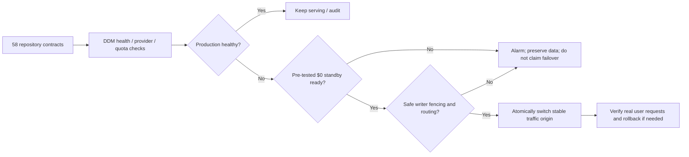

# Development Deployment Monitor (DDM)

**Portfolio-wide reliability and free-host failover control plane.** Every owned repository except the four oldest is enrolled with a versioned, public-safe `.github/deployment-monitor.json` contract. Actual HTTPS monitoring and failover begin only after a verified deployment is registered.

**First four excluded (verified by creation timestamps):** `pupil`, `neurosynth`, `facerec`, `hubs`. On October 20, 2026 there were **58 other existing repositories**, plus this new monitor itself.

## Three levels, not one misleading "up" indicator

1. **Inventory:** Repository registered and contract validated; no active deployment implied.
2. **Monitoring:** HTTPS readiness checked against the live application, correct service and revision. Failures are reported without fabricating successful recovery.
3. **Failover:** Only when the original provider is unhealthy, an independently prepared standby is verified, routing is controlled, the budget remains **$0**, and mutable applications have one fenced writer. A code commit is never proof of a live host.

## Implementation

- `registry/repositories.json` — owner-scoped portfolio and exclusion policy.
- `registry/providers.json` — many possible providers, each capability/cost class and explicit default-disabled actuator.
- `schemas/deployment-contract.schema.json` — integration for each repository.
- `src/cli.mjs` — `node src/cli.mjs inventory`, `validate-client <path> <repo>`, `scan`; no third-party runtime dependencies.
- `docs/ARCHITECTURE.md` and `docs/DEVELOPMENT_PLAN.md` — deployment/failover design and PR roadmap.

**Safety:** No credit card spending, paid instance creation, deletion, DNS change, production write, database cloning, token exfiltration, or secret printing from this public repository. All deployment mutation adapters are off until verified and authorized. The GitHub Actions scheduler runs on a best-effort cadence and is **not instant**; true sub-minute failover requires independently hosted monitoring/routing with ready standby capacity.

**Live status:** Foundation only. No deploy endpoint is yet registered in the new monitor; the portfolio is not falsely reported online.
