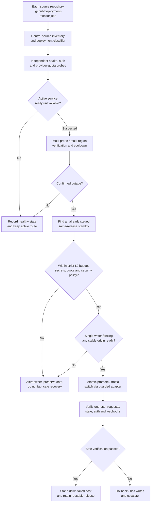

# Development Deployment Monitor — reference architecture

## Mission / scope

Manage deployment health, cost exposure and verified provider relocation for **every GitHub repository owned by neophilism except the first four by creation time**. The first four are pupil, neurosynth, facerec and hubs. On 2026-10-20 the owner had 58 eligible existing repositories; the DDM repository is its own control plane, not another monitored application automatically assumed live. Future repositories enroll under the same policy after source classification. No provisioning on behalf of a library, empty research repo, or unapproved project.

**Absolute cost policy:** US$0 incremental monthly expense unless the owner separately changes that policy. An advertised free allowance is not a spending guard if overages can be billed. Every provider driver fails closed on eligibility unknown, resource cap unknown, active credit-card billing, trial expiration, quota depletion, or unsafe account sharing.

## Human-readable component flow

## Layering and isolation

1. **Inventory layer.** Stable GitHub numeric ID + repository full name + default branch; periodic reconciliation checks creation dates so exclusions are unambiguous. Deployed applications, libraries, jobs, static websites, infrastructure and empty foundations get different lifecycle semantics. A repository without a public endpoint is **inventory only**, never down.
2. **Contract layer.** Each enrolled repo owns one `.github/deployment-monitor.json` with a schema version, workload type, explicit zero-cost cap, health path, desired provider restrictions, and opt-in failover mode. No credentials, addresses of private databases, or sensitive metadata appear in this public file. A shared reusable CI workflow verifies contracts when they change.
3. **Approval and observation layer.** DDM owns `registry/approved-origins.json`; remote manifests cannot trick the monitor into probing arbitrary hosts. The foundation performs safe GET probes with HTTPS, no redirect following, bounded timeouts and exact application-readiness predicates. Later add signed multi-region probe evidence and a tamper-evident durable event ledger. Github Actions `*/5` is an auditor/slow fallback, not instantaneous hosting recovery.
4. **Provider control layer.** Interface `discover, validateEligibility, describeQuota, stageRelease, verifyRelease, pause, resume, destroy`. Implement only supported operations; each provider's adapter is independently tested and read-only by default. No automatic new account, paid tier, overage, GPU or instance upgrade. Providers have *capabilities*: static, Next.js SSR, container, cron/worker, persistent services, database requirements. Do not push every app onto every provider.
5. **Routing and failover layer.** Use a stable application domain per product, independent of where the backend runs. A request-level edge router can fail between already-running, verified origins quickly; building a new host from a Git commit or changing DNS can take minutes and **cannot** be guaranteed immediate. The router must preserve the Host, Set-Cookie, CSRF, OAuth redirect and streaming semantics; provider-origin cross-site rewrites are not implicitly safe. A dedicated Cloudflare Free Worker is an *option*, limited by its 100K requests/day and CPU quotas. An independent secondary watchdog prevents the watchdog becoming a single point of failure.
6. **Stateful consistency layer.** Exactly one writer per app, with persistent lease generation/fencing in the app's *existing* authoritative database before traffic promotion. Different apps may use Neon, file/object storage, blockchain, or external APIs. Never clone, reset or silently migrate records. Where the primary cannot be fenced, fail closed: read-only service or alert instead of risking split-brain financial or account data.
7. **Ownership and dashboard.** DDM owns deployed-revision evidence, health/failover decisions and incident timeline. Boardroom owns development agent assignments. Engine Room consumes DDM health/readiness status as an **external source**; it does not create a competing failover leader. Both are client integrations, not monitor backends.

## Fast versus cold recovery

**Fast option:** multiple domains/regions with one warm or promptly activatable standby, plus always-available stable-edge routing and shared data; request-level routing changes may take seconds *once preconditions are satisfied*. This consumes scarce free resources across 58 repos; reserve warm capacity for highest-priority services. A powered-off backup is **not instant**.

**Cold option:** source revision, artifact, declarative deployment recipe and secret references are retained for 10+ potential providers. When the active host fails, a verified provider adapter attempts the next *eligible* $0 provider. Build and DNS propagation are not instantaneous. Any host requiring a bank card and allowing unbounded overage is disabled by default.

**No false uptime:** the monitor cannot itself guarantee uninterrupted availability when all $0 accounts exhaust their shared quotas or the network/DNS/Neon/GitHub fails. Providers that share an upstream (e.g. free tier account, auth host or Neon region) are correlated failure domains, not independent backups.

## Persisted incident schema (future)

- `deployment`: repository id, immutable code revision, provider target, workload kind, readiness spec, redacted origin id, currently routed state.
- `observation`: time, independently authenticated probe vantage, readiness JSON verdict, latency, code revision, quota class.
- `incident`: deduplication key, prior healthy state, quorum, suspicion window, failure cause, proposed and active routing generation.
- `promotion`: source/target, release digest, quota evidence, writer fencing epoch, compare-and-swap routing transaction, dual-write guard, rollback decision, actor.
- Never store long-lived secrets or complete login/body data in the audit log. Concurrency through unique incident keys, row locks, idempotency tokens and monotone fencing epochs.

## Live-activation safety gates

- Verified provider account connection and explicit `$0` cap, plus alert thresholds.
- Existing credentials in a provider secret manager (not public GitHub). Staging hosts have production write permissions disabled until elected.
- Latest tested release (same Git revision and migrations), readiness HTTP 200 with exact application identity, anonymous owner/API denial, and real authenticated owner login.
- Installed and verified stable domain and TLS, safe cookie/OAuth callback configuration, independent probe quorum, and a tested rollback.
- For mutable apps, a proven writer-fencing epoch and exclusive lease.
- Record a timed provider failover drill against the real app. Only then may `failover.mode` become `auto-verified`. Default `disabled` is deliberate.

## Security boundaries and operational limitations

Public repository contracts are untrusted data; centrally approve origins before probes to prevent SSRF or probing internal resources. Never perform API writes from a read-only scanner. GitHub cron may be delayed or disabled; its existence is not proof of active monitoring. Callbacks from providers must be authenticated, replay-protected and least-privilege. No third-party service can bypass owner-approved authentication or OAuth consent. Preserve actual GitHub status/CI as the source of truth for releases.
